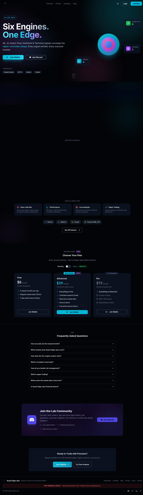

# QuantEdge Labs

**Six engines. One edge.** An AI trading research terminal for stocks, options, and crypto — live at [quantedgelabs.net](https://quantedgelabs.net).

ML, AI, Quant, Flow, Sentiment, and Technical signals converge into higher-conviction setups. Every signal verified. Every outcome tracked.



> **Note:** QuantEdge is an educational and analytical tool — not investment advice and not a recommendation engine. A setup is a hypothesis with its evidence and its record shown.

## What it does

- **NEXUS trading desk** — ideas published with entry, stop, and target, then graded automatically when price hits one or the idea expires. Win rates shown with sample sizes (never below 30 closed trades).
- **Options flow & dark-pool prints** — unusual flow and off-exchange prints surfaced with context, not just raw tape.
- **GEX / dealer positioning** — dealer gamma maps for index sessions (0DTE desk: SPX/SPY levels, dealer map, and same-day flow in one view).
- **Quantinum Bot** — paper-trades NEXUS ideas automatically so every thesis has a live, auditable record.
- **Trade journal** — import broker CSVs (Webull, Robinhood, Schwab, IBKR, tastytrade, TD Ameritrade, Fidelity, E\*TRADE), connect Alpaca read-only, or log by hand. Your book is scored with the same metrics as the bot's.
- **Backtesting & scanners** — strategy simulator, breakout/bull-flag/bear-flag/base-reclaim scanners, after-hours movers.
- **Crypto 24/7** — BTC, ETH, and majors stream from Coinbase around the clock, plus the equity proxies that follow them.
- **Academy, alerts & billing** — learning content, Discord/email alerts, and tiered plans (Free / Advanced / Pro) with Stripe billing.

Every tile shows its data source and how old it is. Delayed feeds (e.g. CBOE chains ~15 min) are labeled as delayed rather than shown as live.

## Tech stack

| Layer | Tech |
|---|---|
| Frontend | React 18, TypeScript, Vite, Tailwind CSS, Radix UI, React Three Fiber |
| Backend | Node.js, Express, TypeScript (ESM) |
| Database | PostgreSQL (Neon serverless) via Drizzle ORM |
| AI | Claude Sonnet, GPT-4, Gemini (pluggable providers) |
| Market data | Alpaca (IEX trades, options chains), Tradier, Yahoo Finance, CBOE delayed feed, Coinbase |
| Auth | Session auth + Google OAuth, invite-code beta onboarding |
| Deploy | Docker, Railway (`railway.json`), `Procfile`, `ecosystem.config.cjs` |

## Getting started

```bash
# 1. Install dependencies
npm install

# 2. Copy the env template and fill in your keys
cp .env.example .env

# 3. Push the schema to your database
npm run db:push

# 4. Run the dev server (app + API)
npm run dev
```

See [QUICK_START.md](QUICK_START.md) for the full walkthrough, [API_SETUP_GUIDE.md](API_SETUP_GUIDE.md) for data-provider keys, and [DEPLOY.md](DEPLOY.md) for production deploys.

Useful scripts:

```bash
npm run build    # production build (client + server bundle)
npm run start    # run production build
npm run check    # typecheck
```

## Project structure

```
client/          React frontend (pages, components, hooks, styles)
server/          Express API (routes, services, scanners, integrations)
shared/          Shared types and Drizzle schema
migrations/      Database migrations
scripts/         One-off tooling and backtests
docs/            Architecture and design docs
```

## Data honesty

A core design principle: the terminal never presents delayed or stale data as live. Each panel carries its source and age, and the free tier runs on 15-minute delayed quotes by default.

## License

MIT — see [LICENSE](LICENSE).
